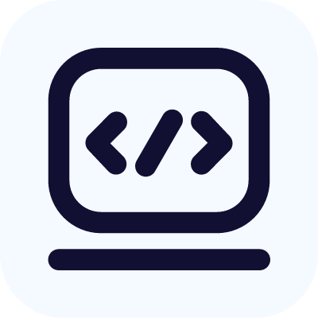
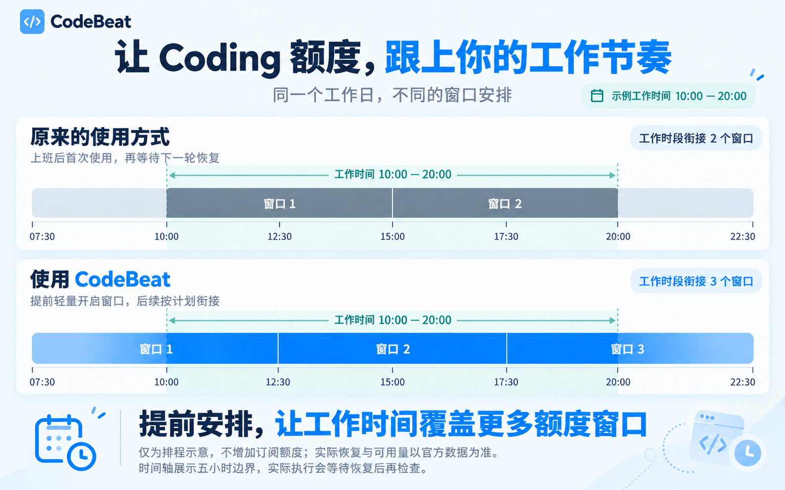
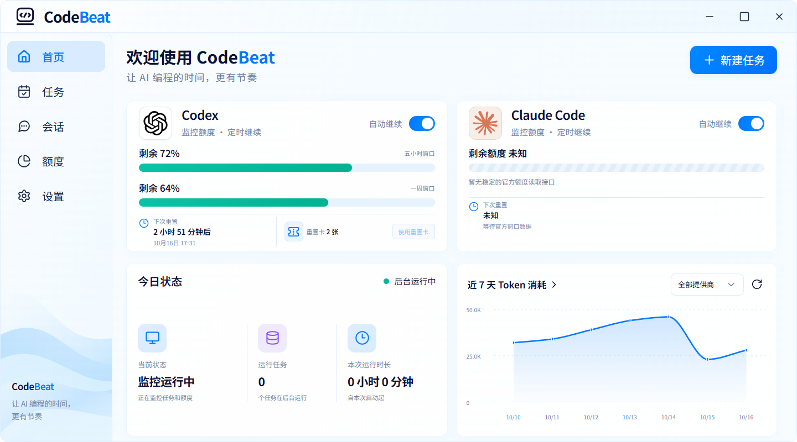
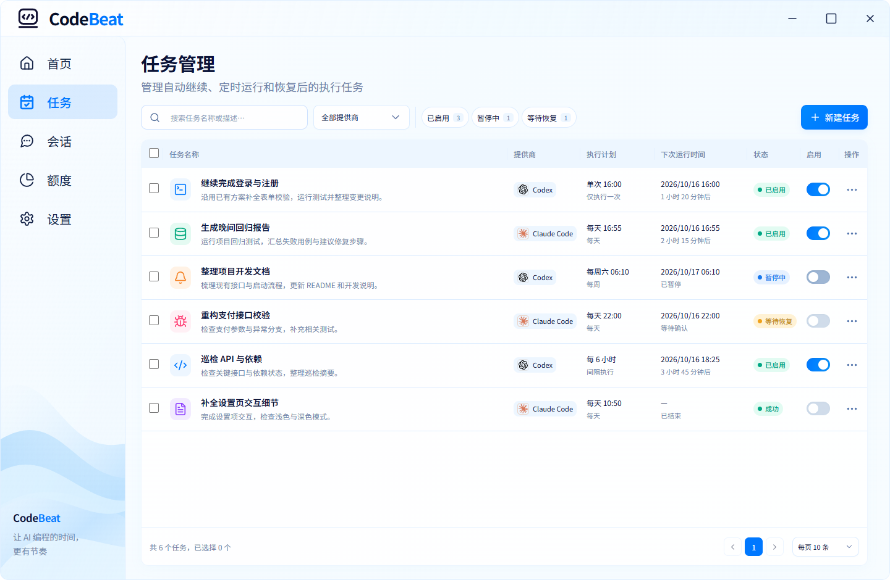
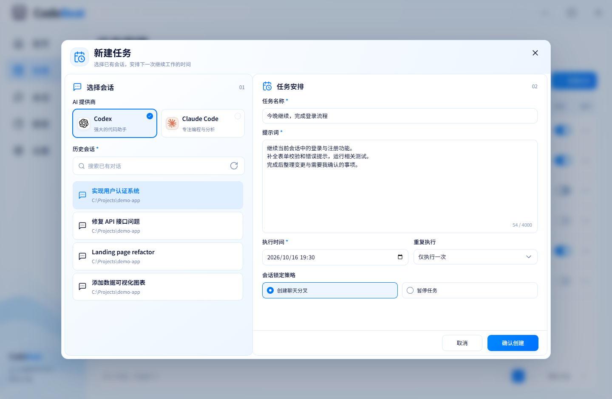
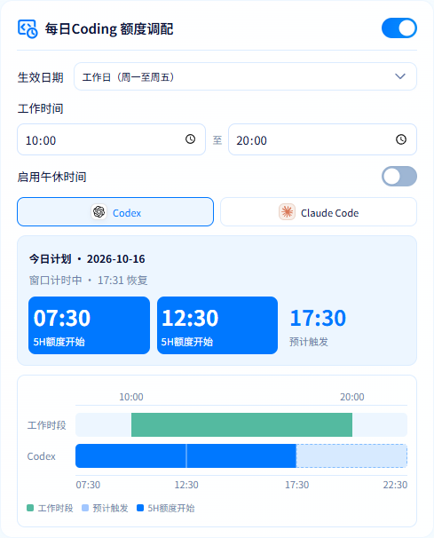
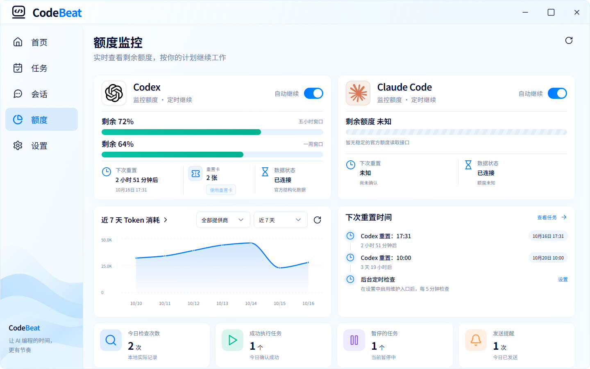

<p align="center">
  
</p>

<h1 align="center">CodeBeat</h1>

<p align="center">
  <strong>把下一段 Coding，安排好。</strong><br>
  为 Codex 与 Claude Code 安排定时续聊，让任务、额度和工作时间更有节奏。
</p>

<p align="center">
  
  
  
  
</p>

<p align="center">
  <a href="#界面与功能">看看界面</a> ·
  <a href="#三步开始">三步开始</a> ·
  <a href="#开发与构建">源码运行</a> ·
  <a href="docs/ARCHITECTURE.md">技术文档</a>
</p>

## 为什么选择 CodeBeat？

不用守着恢复时间，也不用临时想起才继续 Coding。CodeBeat 帮你提前安排额度窗口、定时续聊，让已有订阅更贴合每天的工作节奏。



## 界面与功能

### 首页：先看今天的 Coding 节奏

打开 CodeBeat，先看一眼今天的 Coding 节奏：剩余额度、恢复倒计时、后台运行状态和 Token 趋势集中呈现。想继续手头的项目，点击「新建任务」，安排下一次工作。



### 任务管理：把下一次工作安排好

**选好会话，写下接下来要做的事，安排时间。** 到点由后台执行器调用官方工具继续工作，执行结果通过通知告诉你。



<p align="center"><sub>真实界面 · 演示数据。下文截图中的任务、会话、额度与统计均为示例。</sub></p>

### 下次继续，不用重新交代一遍

从已有 Codex / Claude Code 会话中选择项目，保留对话上下文，再补充本次要完成的工作。一次性任务、每天、每周、按小时间隔，都能直接安排。

会话被其他进程占用时，可选择 **创建聊天分叉** 或 **暂停任务**。执行前还会复查占用状态。



### 给每天的 Coding，留好额度节奏

设置工作时间与午休时段，开启 **每日Coding 额度调配**。默认采用智能均衡、自动轻量触发，并允许尝试唤醒电脑。

- **早上提前用了，就跟随你的时间。** 已确认的首次使用会影响当天的额度周期展示。
- **官方提前重置，时间线跟着更新。** 旧周期截断，后续展示从重置节点重新排列。
- **工作与额度，共用一把时间尺。** 工作时段在上，Codex 周期在下，开始时间与最后一个周期的结束时间一眼可见。
- **展示时间清楚，执行多等一分钟。** 正常情况下，展示 07:30 / 12:30 / 17:30，计划执行为 07:30 / 12:31 / 17:32；执行前仍会检查官方窗口。

<p align="center">
  
</p>

这项功能通过轻量请求尝试开启额度窗口，会消耗少量额度。它不会增加订阅额度，也不会加速官方恢复；是否执行以最新额度证据与任务状态为准。

### 额度、恢复时间、Token 用量，一起看

查看 Codex 五小时与每周窗口的剩余额度、恢复时间、重置卡，以及本地日志汇总的 Token 趋势。官方恢复与重置卡使用会按可确认的信息提供不同提醒。

Claude Code 暂无稳定的官方额度读取接口，页面会明确显示未知；会话排程可以单独使用。



### 把任务交给后台，把结果带回桌面

任务注册到 Windows 任务计划程序，由独立的 Rust 执行器处理。关闭主窗口、收进托盘后，已注册的任务仍可按计划运行。

| 日常场景 | CodeBeat 可以做什么 |
|---|---|
| 今晚接着做 | 给已有会话安排一次续聊，补充清晰的提示词 |
| 每天重复检查 | 设置周期任务，集中查看启用、暂停与待确认状态 |
| 离开电脑一会儿 | 尝试从睡眠唤醒，完成或失败后提供通知 |
| 错过了执行时间 | 新建任务默认询问用户，再决定后续处理 |
| 想知道发生了什么 | 查看任务详情、运行历史与本地日志 |
| 晚上继续 Coding | 切换深色模式，也可跟随 Windows 外观 |

## 三步开始

**1. 连接你正在使用的工具。**

在 Windows 10 / 11 x64 上安装并登录官方 Codex CLI 或 Claude Code，先创建一段已有会话。在 CodeBeat 的「设置」中检测工具连接。

**2. 安排下一次工作。**

打开「任务 → 新建任务」，选择会话，填写任务名称、提示词与执行时间。需要重复执行时，再选择每天、每周或按小时间隔。

**3. 看结果，调整节奏。**

执行后查看通知与任务记录；在「额度」中了解剩余额度，在「设置」中调整工作时间与每日额度调配。

> 新建任务默认使用最高执行权限、开启通知与尝试唤醒，错过执行时间时询问用户。请将任务安排给你信任的项目与会话。

当前为**开发预览版**，可按下文从源码运行或生成安装包。系统需要 WebView2 Runtime；NSIS 安装包会在缺失时引导安装。睡眠唤醒受硬件与 Windows 电源策略影响，关机后无法自动开机。

## 本地保存，使用官方工具执行

任务配置、会话索引、统计与日志保存在本机，CodeBeat 不提供云端存储或遥测。额度查询与模型任务会通过官方工具连接相应厂商服务，适用各厂商的政策及订阅限制。

登录凭据由官方工具管理；CodeBeat 不保存 API key。默认不保存模型完整输出。本地数据库尚未采用 DPAPI 加密，数据处理细节见[隐私说明](docs/PRIVACY.md)。

CodeBeat 是独立开源项目，非 OpenAI 或 Anthropic 官方产品。

## 开发与构建

使用 Node.js 24、Rust stable MSVC、Visual Studio C++ Build Tools 与 Windows SDK，确保终端能够找到 `cargo`、`cl`、`link`、`rc`。

在仓库根目录执行：

```powershell
npm --prefix desktop ci
cargo build --locked -p codebeat-runner
New-Item -ItemType Directory -Force desktop/src-tauri/binaries
Copy-Item target/debug/codebeat-runner.exe desktop/src-tauri/binaries/codebeat-runner.exe
npm --prefix desktop run desktop
```

只预览前端可运行 `npm --prefix desktop run dev`。普通预览不会连接桌面服务或模拟任务数据；README 的演示数据仅由独立的截图测试注入。

```powershell
./scripts/verify.ps1                    # Rust 检查、测试及前端构建
npm --prefix desktop test               # 前端单元测试
npm --prefix desktop run test:ui        # 页面回归检查
npm --prefix desktop run bundle         # 生成 Windows 安装包
```

安装包输出：`target/release/bundle/nsis/codebeat-Setup-x64.exe`，同目录提供 `SHA256SUMS` 与构建信息。

### 项目结构

```text
crates/codebeat/          核心逻辑、数据库、提供商与 Windows 原生集成
crates/codebeat-runner/   独立后台执行器
desktop/                 Vue 3 界面与 Tauri 桌面程序
docs/                    架构、功能、隐私说明与宣传截图
scripts/                 构建、验证与诊断脚本
```

### 文档与贡献

| 文档 | 内容 |
|---|---|
| [架构说明](docs/ARCHITECTURE.md) | 任务执行、额度周期、数据库与系统集成 |
| [功能说明](docs/FEATURES.md) | 功能实现与适用边界 |
| [交付与验收](docs/DELIVERY.md) | 验证记录与待人工检查项目 |
| [隐私说明](docs/PRIVACY.md) | 本地数据与厂商通信 |
| [第三方声明](docs/THIRD_PARTY.md) | 依赖、字体与许可证 |
| [截图制作](docs/images/readme/README.md) | 演示数据说明与截图重新生成方法 |

欢迎通过 Issue 分享使用场景、反馈问题，也欢迎提交 PR。提交前请运行 `./scripts/verify.ps1`；涉及唤醒、计划任务或额度判断时，请附上实际验证范围。

## 许可

[MIT License](LICENSE)。内置 CodeBeat UI 字体基于 Noto Sans SC，遵循 OFL 1.1；详见[第三方声明](docs/THIRD_PARTY.md)。
