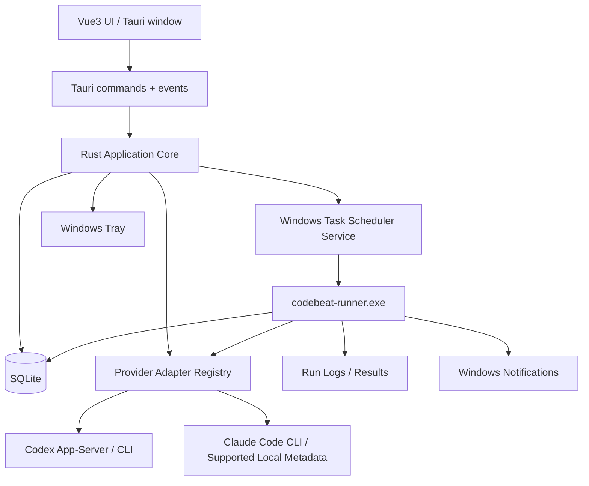
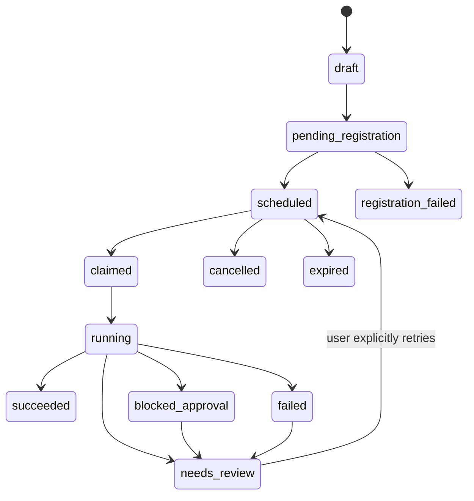

# codebeat 完整技术规格与工程实施方案

**文档版本** 1.0 | **日期** 2026-10-16 | **性质** 可交给本地 Codex 的实施规格（不是现成产品）

## 0. 执行摘要与硬性约束

codebeat 是 Windows 10/11 x64 桌面工具，首批仅集成 **OpenAI Codex**、**Claude Code (CC)**，拥有托盘常驻、桌面仪表盘、真实额度及恢复时间、提前/完成提醒、本地历史会话检索、指定会话定时续聊、每日 06:00 可选额度窗口预触发、睡眠唤醒、关机错过后可控补执行、任务历史与诊断。面向普通用户的发布成果是 `codebeat-Setup-x64.exe`：不得要求安装 Rust/Node/.NET SDK，原则上也不得要求用户操作终端。

**交付底线：** 没有可信额度数据时必须显示「未知」；没有可恢复会话时必须阻止创建续聊任务；不能将进程启动当作执行成功；没有唤醒计时器权限时要给用户可操作诊断；不能绕过工具订阅限制，也不能未经明确同意以 `--dangerously-skip-permissions` 等高风险模式运行。不要承诺关机时自动开机；不要保证模型额度必然按固定 5 小时恢复；不要将演示 UI 数据写成真实数据。

**模块的完成定义**：真实代码 + 单元/集成测试 + 失败路径 + 文档 + Windows CI，不能用假实现或静态页面蒙混过关。凡第三方当前没有公开稳定接口的能力，必须标注 `unsupported` 或 `unavailable`，并在 UI 说明，而不是从网页 Cookie/私有接口偷取数据。

## 1. 范围

### 1.1 P0（首个可用正式版）

1. 安装、卸载、托盘、开机自启、单实例、打开/隐藏主窗口、基本中英文界面（默认简体中文）。
2. 检测 Codex、Claude Code 命令及登录状态（尽最大可能利用安全、非侵入式检测）；查看版本、位置、测试连接，给出缺失时安装说明链接。
3. Codex 真正结构化额度（优先 `codex app-server` 的 `account/rateLimits/read`）；Claude Code 尽力提供真实额度和重置时间，无法读取时显式未知，允许打开官方用量入口，不能用推算冒充实际值。
4. Provider 会话列表：Codex App-Server `thread/list` 分页搜索，Claude Code 依官方 CLI 机制和可读取的本地会话元数据实现列表、验证及恢复；项目 cwd + ID 必须保存。
5. 创建一次性任务：选择 Provider、会话、时间（本地时区）、提示词、工作目录、权限模式、唤醒开关、错过策略。支持编辑、取消、立即执行、日志、结果、通知。
6. Windows 任务计划程序创建每个任务对应的独立唤醒入口；睡眠可按平台政策唤醒；关机错过后启动/登录补执行；不依赖 GUI 持续运行。
7. 提前 10 分钟重置提醒、重置确认提醒、任务成功/失败提醒；通知需去重。每日 06:00「预触发」可独立启用且默认**关闭**，有清晰额度消耗风险提示；需真实任务请求、成功状态和最新服务器窗口数据，不能盲目判定。
8. 单文件执行器 / CLI 子命令、SQLite 持久化、数据迁移、日志轮转、故障诊断页、Windows 构建和 NSIS 安装包、README、开源许可证草案。

### 1.2 P1（P0 通过后）

- 周期任务（工作日/每周）、执行前额度就绪判定与等待策略、精细化用量历史、主题切换、执行前模拟检测、国际化完善、自动更新（签名后）、多账号选择（只在厂商允许且可验证情况下）。
- 多窗口/多会话筛选、高级重试、失败原因分类、可导出的脱敏诊断包。

### 1.3 明确不做

- 不直接控制 Codex/Claude 的服务器重置、不破解配额、不切换多个账户以绕开额度限制、不共享密钥或登录 Token、不云端托管会话、不默认上传代码、不使用模拟鼠标操作桌面软件、不承诺 1:1 跨工具历史会话互通。

## 2. 技术选型与理由

| 层 | 选择 | 原因与约束 |
|---|---|---|
| 界面 | Vue 3 + TypeScript + Vite | 易实现设计稿、组件复用、类型明确 |
| 桌面容器 | Tauri 2 | Rust 原生层/托盘/通知/窗口 + Windows WebView2 |
| 执行器 | 独立 Rust binary `codebeat-runner.exe` | 由任务计划程序调度，无需 UI 常驻；建议与主程序同安装目录 |
| 后台 | Rust stable + Tokio | 并发 I/O、子进程/JSON-RPC、生命周期控制 |
| 数据 | SQLite + `sqlx`/`rusqlite` | 事务、WAL、迁移、可诊断；二选一，项目统一 |
| 调度 | Windows Task Scheduler 2.0 COM（优先 Windows API） | 可设置 WakeToRun、StartWhenAvailable、失败重试等；不建议依赖字符串拼接 schtasks 命令 |
| 通知 | Tauri notification + WinRT/Toast 封装 | 主 UI 与独立执行器都可通知；身份/AppUserModelID 需验证 |
| 安装 | Tauri NSIS `setup.exe` | 普通用户双击安装、WebView2 缺失时引导处理 |
| 配置 | SQLite + 极少量 settings JSON | 路径在 `%LOCALAPPDATA%\\codebeat`，配置迁移 |
| CI | GitHub Actions Windows runner | cargo fmt/clippy/test、npm test、build、打包/发布 |

**发布口径**：一个用户可下载安装包，安装后可以包含主 EXE 与独立 runner EXE；不必强求磁盘上只有一个进程文件。此前 15–30 MB 只是目标，必须以实际 release artifact 大小为准。Tauri 依赖 Windows WebView2 Runtime；不能把「无需 SDK」误写成「完全不需要任何系统运行组件」。

## 3. 系统架构



主 GUI 职责：展示、配置、读取状态、发起任务。Core 管状态机、provider 协议、任务配置、数据库、权限规则。**Runner 才是执行权威**：被 Task Scheduler 唤醒时，从 DB 读取任务、原子抢占、启动 Provider，写回运行状态、发送通知。即使 GUI 被关闭/托盘崩溃，已注册任务仍可执行。

### 3.1 单实例与进程通信

- 桌面单实例，二次启动应唤出已有窗口。
- Runner 命令：`codebeat-runner.exe run --task-id <uuid>`、`recover-missed`、`check-health`。参数不包含 prompt、密钥或完整项目路径；在 DB 中查找。
- 任务锁：SQLite `UPDATE ... WHERE state='scheduled'` + 事务；在获取锁之前不得启动 Provider。`running` 且心跳过期的任务进入 `needs_review`，不能无脑重试破坏幂等性。
- 主程序与 Runner 使用同一数据库和安装路径；采用文件锁与 WAL，所有事务有 busy timeout，重要字段写入立即提交。

### 3.2 实现目录建议

```text
codebeat/
├── README.md
├── LICENSE
├── package.json
├── src/                        # Vue pages/components/i18n/stores
│   ├── pages/Overview.vue
│   ├── pages/Providers.vue
│   ├── pages/Schedules.vue
│   ├── pages/History.vue
│   ├── pages/Settings.vue
│   ├── components/UsageCard.vue
│   ├── components/SessionPicker.vue
│   └── components/ScheduleEditor.vue
├── src-tauri/
│   ├── tauri.conf.json
│   ├── capabilities/default.json
│   ├── icons/
│   ├── src/main.rs
│   └── src/lib.rs
├── crates/
│   ├── codebeat-core/            # domain, scheduler, state machine
│   ├── codebeat-db/              # schema, migrations, repo
│   ├── codebeat-providers/       # Codex/Claude adapters
│   ├── codebeat-windows/         # task scheduler, Windows notifications
│   └── codebeat-runner/          # independent binary
├── migrations/
├── tests/fixtures/             # sanitized JSON and session metadata
├── assets/                     # licensed visual assets
├── docs/
└── .github/workflows/
```

`codebeat-core` 尽量无 Tauri 依赖，可独立测试/命令行执行。所有 provider-specific 解析/调用必须留在 `codebeat-providers`，Vue 不直接知道 CLI 输出文本或本地 session 文件布局。

## 4. 设计规范与视觉素材

### 4.1 品牌重命名

- 显示品牌：**codebeat**；安装包：`codebeat-Setup-x64.exe`；进程建议：`codebeat.exe`、`codebeat-runner.exe`；AppUserModelID 示例：`org.codebeat.app`（发布前核对唯一性和命名）。
- `assets/logo-reference.png` 是此前用户认可的视觉方向：月牙环抱终端窗口、`</>_`、睡眠 zzz；**图中文字 CodeNap 是历史参考而不是现用商标，必须重制为 codebeat**。
- `assets/ui-*.png` 是四版整体配色/布局参考，亦含 CodeNap 旧字样、旧日期和虚构额度，不得复制样例数字到实际界面。
- 不能把示例素材中的「Codex 8/40」当真实官方用量单位：界面显示 `% used` / `% remaining` 和数据来源/更新时间；如没有请求数单位则不显示 `8/40`。

### 4.2 页面信息架构

**总览 Overview**：两张额度卡片、下一次重置、卡片数据可信度及更新时间、即将执行任务、启动/暂停快捷操作、运行异常提醒。**Providers**：检测 Codex 和 Claude、版本/路径、登录连接诊断、额度读取机制、强制刷新、授权权限说明。**定时任务 Scheduled Tasks**：列表、过滤、日期/状态、创建与编辑、暂停/恢复、执行一次、删除；选择 Provider → 搜索历史对话 → 选项目 cwd → 选开始时间/时区 → 输入提示词 → 设置安全模式/唤醒/补执行/通知 → 预览确认。**History**：运行/失败分类、开始/结束、日志和结果。**Settings**：开机自启、关闭行为、通知提前量、每天 06:00 预触发开关、默认错过策略、默认授权范围、主题/语言、诊断。

### 4.3 样式令牌（起点，不是最终定稿）

- 默认浅色：canvas `#F7F8FC`, surface `#FFFFFF`, border `#E6E9F2`, text `#17213B`, muted `#64748B`, primary `#4F46E5`（靛蓝）, hover `#4338CA`, accent `#0D9488`（青绿）, warning `#D97706`, danger `#DC2626`, success `#059669`。
- 完成用户选色前，UI 应当支持主题 token 化；不得在页面硬编码几十处色号。可提供 `indigo / teal / navy / warm` 四套主题。
- 窗口建议最小 1024×700，理想 1280×820；720 宽以下任务创建页改为独立弹窗/全屏页；响应系统 DPI、深浅色。
- 可访问性：键盘导航、焦点可见、颜色不作为状态唯一表达、WCAG AA 对比度目标、图标 tooltip、进度 aria 属性、屏幕阅读器标签。
- 设计稿全部是视觉参考，开发时必须实现真实交互和空态/加载/错误态。

## 5. 统一领域模型与 Provider 抽象

```rust
#[derive(Debug, Clone, Copy, Serialize, Deserialize)]
pub enum ProviderId { Codex, ClaudeCode }

#[derive(Debug, Clone, Serialize, Deserialize)]
pub struct UsageWindow {
    pub label: String,
    pub used_percent: Option<f64>,
    pub resets_at_utc: Option<chrono::DateTime<chrono::Utc>>,
    pub duration_minutes: Option<i64>,
    pub observed_at_utc: chrono::DateTime<chrono::Utc>,
    pub source: String,
    pub reliability: UsageReliability,
}

#[derive(Debug, Clone, Serialize, Deserialize)]
pub enum UsageReliability { Official, LocalObserved, Unknown }

#[derive(Debug, Clone, Serialize, Deserialize)]
pub struct Conversation {
    pub provider: ProviderId,
    pub session_id: String,
    pub title: String,
    pub cwd: std::path::PathBuf,
    pub last_updated_utc: Option<chrono::DateTime<chrono::Utc>>,
    pub resumable: bool,
    pub source: String,
}

#[async_trait::async_trait]
pub trait CodingProvider: Send + Sync {
    fn id(&self) -> ProviderId;
    async fn detect(&self) -> anyhow::Result<ProviderHealth>;
    async fn usage(&self) -> anyhow::Result<Vec<UsageWindow>>;
    async fn list_sessions(&self, query: SessionQuery) -> anyhow::Result<SessionPage>;
    async fn verify_session(&self, conversation: &Conversation) -> anyhow::Result<()>;
    async fn resume(&self, run: &RunRequest, events: EventSink) -> anyhow::Result<RunOutcome>;
}
```

`UsageWindow` 可以同时表达 5 小时与每周窗口（以及未来变化）；没有可靠数值就存 `None`。`detect()` 可以在未登录时返回健康状态提示，而不必直接抛出无法分类的错误。实现动态能力矩阵 `Capabilities { usage, sessions, resume, unattended, structured_events }`，防止 UI 承诺不支持的功能。

## 6. Codex 适配器

### 6.1 优先官方 App-Server

进程 `codex app-server`（准确参数与协议握手以开发时安装版本的 `--help` 和官方说明为准），通过标准输入/输出进行 JSON-RPC 协议通信；支持版本初始化、请求 ID、超时、心跳、失败后的进程重启、stdout JSON 逐行解帧、stderr 分流日志。不可把 stderr 当 JSON；读取标准输出必须持续消费，避免 pipe 堵塞。

功能建议：`account/rateLimits/read` 读取真实 rate-limit 窗口；`thread/list` 获取分页会话（按 updatedAt 排序、searchTerm 查询）；`thread/read` 检查会话元信息和可恢复性。API 字段以当前 app-server schema 为准，不假设所有账号都有 `primary` / `secondary`，也不假设 primary 一定是 5 小时。

恢复执行优先选兼容而可控制审批的 app-server 线程/turn 协议；如第一版优先使用 CLI，可采取明确备用 `codex exec resume <session-id> <prompt>`，**实际 CLI 命令、cwd 传递和权限参数必须做版本兼容集成测试**。不能假设桌面应用每个会话都一定能被 CLI 恢复；若不可恢复，则 UI 显示不可调度。

### 6.2 06:00 预触发语义

用户启用后，每天本地时间 06:00 调用预设的安全只读最小化请求。前置条件：用户已明示该请求会消耗额度、当前 Provider 在线且授权、使用窗口类型/首次请求起点确实符合目标、没有正在运行的冲突任务。执行后再次读取真实额度窗口；若窗口并未改变，状态记为 `trigger_unconfirmed` 而非「已重置」。服务端有别的滚动/周限额时必须按实际规则展示。**默认关闭**，防止意外消耗。

## 7. Claude Code 适配器

### 7.1 执行与会话

利用 Claude Code 官方 CLI 的非交互式 `claude -p ...`、`--resume <session-id>`、结构化 `--output-format`（以当前版本兼容性测试为准），cwd 设为会话所在项目目录。可验证命令形态：`claude --resume <id> -p '<prompt>'`，实际进程调用必须使用 Rust `Command.arg` 独立传参数，绝不 `cmd /c` 拼接可注入的 prompt。

会话列表：优先 CLI 支持的列表/交互能力；如果没有稳定机器可读 API，读取**用户本机** Claude Code 会话摘要/metadata（常见存储于用户主目录下 `.claude/projects` 等）作为 best-effort，并对版本差异、脱敏、session ID/项目路径映射做验证；不编辑用户已有原始会话文件，目录不存在视为空；避免扫描用户全部磁盘。需要针对中文标题、巨大 transcript、损坏 JSONL、路径符号链接、重命名项目做测试。

### 7.2 Claude 额度

Claude Code 的 `/status` 可能只提供帐号/模型/目录/版本，并非可稳定用于读取全部使用额度的机器接口。**严禁**把 `/status` 输出当作已经验证的 5 小时额度数据源。适配器先调查最新受支持的官方用量/限额接口、CLI 是否提供结构化字段；没有可靠机器读取机制就给出 `Unavailable/Unknown`，允许用户点击官方使用量页面或在 Claude 交互界面自行检查。不能绕过登录、抓 Cookie、抓浏览器会话或模拟私有限额 API。

### 7.3 权限/无人值守

默认进入受限安全模式：对未知审批请求置 `awaiting_approval` 并提醒用户，**不要默认自动通过破坏性命令**。如果用户明确选择并确认运行权限，可采用厂商支持的受限 allowed-tools 权限配置；不要在初始版本使用 `--dangerously-skip-permissions`。对可能需要交互审批的 CLI 执行需超时/受阻识别，并转为 `blocked_approval`，不能无限卡住。

## 8. Windows 睡眠唤醒与计划任务

### 8.1 调度策略

**每一个计划任务对应一个 Windows Task Scheduler 条目**，Action 启动 `codebeat-runner.exe run --task-id UUID`，触发时间为用户选择的当地 wall-clock 时间，并保存原始时区 IANA/Windows TZ ID、UTC instant、创建时偏移。设置：`WakeToRun=true`（用户允许时）、`StartWhenAvailable=true`（用户选择补执行时）、`ExecutionTimeLimit`（合理超时）、`MultipleInstancesPolicy=IgnoreNew/Queue` 以避免重复触发。注册为当前用户任务（最小权限，不默认要求管理员）。计划任务文件名包含不敏感的 UUID，禁止放 prompt。

`Task Scheduler` 在睡眠唤醒方面受系统、电源模式和 BIOS/UEFI 影响；允许唤醒计时器、插电策略和现代待机可能不受控，不能保证所有设备一定被唤醒。建议「运行前系统检测」读取 `powercfg /waketimers`、平台可支持睡眠状态、Windows 计划任务最近结果；运行后验证任务实际触发并反馈诊断。

### 8.2 关机与错过补执行

- 用户明确选择：`run_on_next_start` / `skip` / `ask`；默认 `ask` 或在 MVP 中默认 `skip`，不要默认把几天前已过期的代码修改任务直接执行。
- 开机恢复时依据任务 ID 和状态判定：若完成，绝不重跑；若未开始且超时阈值内，按策略运行；若超过 TTL（默认如 12 小时，可设置），标记 `expired`，等待确认。
- 新任务创建先写 DB `pending_registration` → 注册 Windows Task Scheduler → 更新 `scheduled`；失败补偿回滚/标记并显示诊断。删除反向操作也要容错。
- 睡眠后执行时 Windows 可能处在锁屏会话：Runner 不依赖 GUI/浏览器；保证用户环境、CLI 登录令牌、项目文件可访问。若磁盘加密、网络、VPN、密钥链或用户登录态阻止操作，应失败并通知，而不是尝试解锁系统。
- 任务结束后**不要强制睡眠**；用户可在 P1 选择在确认无人活动时恢复系统休眠。避免打断前台工作。

### 8.3 系统异常矩阵

| 情况 | 行为 |
|---|---|
| 设备运行中 | 按计划执行 |
| S3 睡眠 + 允许唤醒 | 尝试定时唤醒；若失败记录诊断 |
| S0 现代待机 | 依设备和电源策略，有失败概率 |
| 休眠 Hibernate | 依设备/任务计划设置，不能保证 |
| 关机 | 不能自动开机；下次开机按错过策略 |
| 笔记本未插电 | 可默认提示建议仅 AC 执行，可配置 |
| 密码锁屏 | Runner 在预设用户环境执行，不能解锁 |
| 计划任务权限不足 | 注册失败、给修复指引，不造假 |
| 重复唤醒 | DB 任务锁幂等阻止重复启动 |
| 夏令时/时区更改 | 将原 schedule 规则与 UTC instant 同时保存；明确重复/不存在时刻策略 |

## 9. 任务状态机与失败处理



- Runner 在 `claimed` 时持久化 `run_id`, PID, timestamp, attempt_no。写入结果后触发通知；通知失败不能回滚业务成功。
- **at-least-once 外部调度 + 本地去重**：对可能已经提交给模型、但进程失联的请求，**不允许自动重复发送**，需人工审查，以防重复改动代码或重复花费额度。
- 同 Provider + 同 conversation 默认只能有 1 个 active job；不同 Provider/项目可配置并发上限（MVP 全局上限建议 1，后续 2）。
- 超时分类：CLI 未找到、未登录、无额度、会话丢失、cwd 不存在、权限被拒、依赖网络不可用、执行器崩溃、日志写入失败。错误需给 UI 用户级说明和技术码。返回码 0 且没有可靠成功事件时可标记 `completed_unverified`，不得自动当作测试通过。
- 每个 run 包含事件流：`queued/start/model_output/tool_event/approval_needed/end/error`（脱敏，限制大小）；日志按大小轮转，如 10MB×5；模型完整输出可由用户选择不保存。

## 10. SQLite 数据库设计

```sql
PRAGMA journal_mode=WAL;
PRAGMA foreign_keys=ON;
CREATE TABLE providers (
  id TEXT PRIMARY KEY, executable_path TEXT, version TEXT,
  detection_status TEXT NOT NULL, last_checked_at TEXT, capability_json TEXT NOT NULL
);
CREATE TABLE conversations (
  provider_id TEXT NOT NULL, session_id TEXT NOT NULL,
  title TEXT NOT NULL, cwd TEXT NOT NULL, source TEXT,
  resumable INTEGER NOT NULL DEFAULT 0, updated_at TEXT,
  PRIMARY KEY(provider_id, session_id)
);
CREATE TABLE usage_snapshots (
  id TEXT PRIMARY KEY, provider_id TEXT NOT NULL,
  window_label TEXT NOT NULL, used_percent REAL,
  reset_at_utc TEXT, duration_minutes INTEGER,
  observed_at_utc TEXT NOT NULL, source TEXT NOT NULL,
  reliability TEXT NOT NULL
);
CREATE TABLE tasks (
  id TEXT PRIMARY KEY, provider_id TEXT NOT NULL,
  session_id TEXT, title TEXT NOT NULL, prompt TEXT NOT NULL,
  cwd TEXT NOT NULL, scheduled_at_utc TEXT NOT NULL,
  scheduled_local TEXT NOT NULL, timezone_id TEXT NOT NULL,
  state TEXT NOT NULL, wake_to_run INTEGER NOT NULL,
  catch_up_policy TEXT NOT NULL, catch_up_ttl_minutes INTEGER,
  permission_profile TEXT NOT NULL, task_scheduler_name TEXT,
  created_at TEXT NOT NULL, updated_at TEXT NOT NULL
);
CREATE TABLE task_runs (
  id TEXT PRIMARY KEY, task_id TEXT NOT NULL REFERENCES tasks(id),
  attempt INTEGER NOT NULL, state TEXT NOT NULL, started_at TEXT,
  finished_at TEXT, exit_code INTEGER, pid INTEGER,
  error_code TEXT, error_message TEXT, log_path TEXT,
  UNIQUE(task_id, attempt)
);
CREATE TABLE notification_dedup (
  dedup_key TEXT PRIMARY KEY, emitted_at TEXT NOT NULL
);
CREATE TABLE app_settings (
  key TEXT PRIMARY KEY, value_json TEXT NOT NULL
);
CREATE INDEX idx_tasks_due ON tasks(state, scheduled_at_utc);
CREATE INDEX idx_usage_recent ON usage_snapshots(provider_id, observed_at_utc DESC);
```

生产化应将 prompt 等敏感数据保存于用户私有目录，设置 ACL 限制当前 Windows 用户访问；考虑 Windows DPAPI 对提示词/敏感字段加密（优先以低风险的用户作用域方案，分析备份迁移后果）；绝不保存 CLI 认证明文或 API key。数据库迁移版本化、回滚和备份。清理旧快照默认保留 30 天，执行日志默认 14 天且可配置。

## 11. Rust ↔ Vue IPC 契约

### Tauri Commands 建议

- `get_dashboard() -> DashboardDto`
- `list_providers() -> Vec<ProviderDto>`
- `detect_provider(id) -> ProviderHealthDto`
- `refresh_usage(id) -> UsageDto`
- `list_conversations(provider, search, cursor, limit) -> SessionPageDto`
- `create_task(CreateTaskRequest) -> TaskDto`
- `update_task(id, patch) -> TaskDto`
- `cancel_task(id) -> ()`
- `run_task_now(id) -> RunId`
- `list_tasks(filter) -> Vec<TaskDto>`
- `list_run_history(task_id, cursor) -> Page<RunDto>`
- `get_run_log(run_id, offset, limit) -> LogChunk`
- `get_settings()/update_settings(patch)`
- `get_wake_diagnostics() -> WakeDiagnosticDto`

`CreateTaskRequest` 必须校验：provider 存在、会话可恢复、工作目录存在且在用户授权列表、时间符合约束、提示词长度限制、权限模式合法、wake/catch-up 配置可序列化。Tauri capability 中只允许前端调用明示命令，禁止通用 arbitrary-shell API。

### UI 事件

`provider-health-updated`, `usage-updated`, `task-updated`, `run-progress`, `notification-error`；事件 payload 带 id、serverTimestamp、version，防止 out-of-order 覆盖新状态。窗口隐藏时不必持续每秒刷新所有指标，可用定时采样和事件触发。

## 12. 主窗口、托盘与用户操作

- 首次启动 → 欢迎页 → 自动检测两 Provider → 展示是否就绪 → 引导检查唤醒能力 → 安全权限介绍 → 进入总览。
- 托盘左键/双击：显示主窗口；右键：打开、立即刷新额度、查看任务、暂停所有调度（仅暂停本软件后续执行）、设置、退出。关闭主窗口默认**隐藏到托盘**，首次发生时 Toast/气泡解释；「退出」需要明确告知已注册系统任务可能独立继续执行，并提供取消/保留选择。
- 刷新间隔：额度后台查询如每 5 分钟（可改），失败指数退避；重置前提醒用 server resetsAt 作为依据，重置后再实际查询证实「额度已恢复」才发确认通知。若无法查证，仅通知「预计重置时间已到，请检查额度」。
- 通知：提前 10 分钟、确认恢复、任务执行完成/失败、需要审批、错过待确认。每个窗口+事件创建 dedup key，重启不会重复提醒。
- 本地化：至少 `zh-CN`、`en-US` 资源文件；日期展示以当地时区，存储以 UTC；程序日志统一 ISO 8601 UTC。

## 13. 进程与运行安全

1. 使用 `tokio::process::Command` / `std::process::Command` + 独立 `arg()`，禁止 shell 拼接；对 executable path 用用户同意的检测结果，不让任务任意执行任意 exe。
2. 启动目录使用所选会话所属 cwd；规范化路径并验证目录实际存在、会话和 cwd 一致。按用户于 2026-10-17 的变更要求，项目目录默认可用，不再使用目录授权白名单或请求授权勾选；设置里的目录列表仅用于常用项目选择。
3. 默认非管理员运行；不请求无必要 UAC elevation。Windows Task Scheduler 注册当前用户任务，无法按设置唤醒时提示需人工修复的权限/电源设置。
4. 令牌和账号状态由官方 CLI 保管；CodeBeat 不读取/上传认证材料。
5. 日志自动遮挡常见 secret、Bearer Token、路径中用户个人信息（诊断包导出前进一步用户确认）；禁用遥测默认状态。
6. 执行用户提示词是预期行为，但应清晰提示 AI 工具可能产生实际代码和命令改动；无人值守权限模式需单独确认，并且应支持取消/停止（软中断然后超时杀进程树）。
7. 出现 CLI 交互弹窗或审批不能无人值守完成时，转 `blocked_approval`；不自动宽松授权。
8. 打包给用户前加入 LICENSE、隐私策略、第三方声明：该产品非 OpenAI/Anthropic 官方。

## 14. 开发阶段与可验收交付

### Phase A：项目骨架与视觉（独立可运行）

初始化 pnpm/npm Vue+TS、Tauri 2、Rust workspace；设置名称/图标/manifest，五页路由和主题、中文本地化、托盘/单实例/隐藏窗口，提供真实空态和 UI mock adapter（仅测试模式可用）；所有页面都不能硬编码演示数据为生产数据。**验收**：Windows 本地 `tauri dev` 能启动/隐藏/恢复，无前端控制台错误。

### Phase B：数据层/Provider 检测

SQLite migrations、命令检测、版本和授权检查、健康状态、日志；统一接口和失败类型。**验收**：两工具未安装/仅一个/都装/未登录 4 种情况均显示准确。

### Phase C：额度

Codex App-Server JSON-RPC 客户端 + structured rate limits；Claude 支持情况下读取官方数据，否则呈未知；倒计时基于真实 reset instant；可靠性标识。**验收**：fixture 测试百分比缺失、周窗口、限额异常、刷新过期、进程退出。

### Phase D：会话

Codex `thread/list` 分页/搜索 + `thread/read`；Claude metadata scanner（只读）和 resume 验证。**验收**：空、中文、1万条分页、文件损坏、会话删除、项目移动。

### Phase E：Runner 和 Windows 调度

Runner binary/DB claims、任务计划程序 COM 注册/移除、WakeToRun、StartWhenAvailable、进程流日志、CLI resume、安全权限。**验收**：5 分钟后执行测试任务、睡眠唤醒回归、机器重启后的补执行、重复触发只有一次、无 GUI 运行。此阶段需要 Windows 真机测试，CI 虚拟机不能充分证明唤醒可靠。

### Phase F：通知/06:00 预触发/任务历史

任务提前提醒、恢复确认、失败提示、预触发选项（默认关）、事件日志和运行详情。**验收**：防重复通知，预触发执行但限额未变显示未确认，计划任务失败有明确引导。

### Phase G：打包发布

Windows x64 CI、NSIS、WebView2 配置、资产重命名、安装/升级/卸载、数据保留/删除、生成 SHA-256、README、隐私/许可证说明、Release 草稿。**验收**：全新 Win11 和 Win10 VM 不装 SDK 即可下载安装；缺 WebView2 时合理安装/错误指引；杀 GUI 后定时执行仍正常；SmartScreen 未签名提醒明确记录为分发风险。

## 15. 测试矩阵

### 单元测试

`rate_limits_parser`: primary/secondary 缺失、数值异常、窗口改变、UTC 秒/毫秒；`task_state`: 幂等 claim/retry/expire；`session_parser`: BOM/UTF-8/中文/截断 JSONL；`timezone`: 跨天/夏令时；`arguments`: Unicode/引号/换行 prompt 无 shell 注入。

### 集成测试

伪 CLI 可控制 stdout/stderr/exit code/挂起；本地 mock app-server JSON-RPC 回答/通知；SQLite 多进程抢占；Windows Task Scheduler 注册/删除（测试 namespace，清理干净）；通知 API fallback；主程序退出 Runner 依然执行。

### 手工 Windows E2E

- Win11 x64，Win10 x64（各至少一台或 VM，睡眠测试需实体机）
- 没有 CLI/只 Codex/只 Claude/两者都有，登录/过期登录
- 不同订阅账号与窗口规则（不可假设全为 5 小时）
- 中文路径/用户名、OneDrive 路径、项目搬家、磁盘休眠
- S3/S0、插电/电池、锁屏、关机后重启、启动时网络不可用
- 不同 DPI 100%/150%/200%、简中/英文系统、深浅色
- 任务运行中断电或崩溃、重复唤醒、执行结果迟到
- NSIS 安装、修复、升级、卸载，保留历史数据选择

## 16. GitHub Actions / 构建和交付

- 针对 `windows-latest` 建立 matrix 单一 x64；固定 Node LTS、Rust stable、Tauri 2 minor/lockfile，并安装 MSVC 构建组件；CI 使用 `pnpm install --frozen-lockfile` 或 `npm ci`，`cargo test --workspace`、`cargo clippy --workspace -- -D warnings`、`cargo fmt --check`、`npm run build`。
- `tauri build` 输出 NSIS installer；确保 runner 被纳入 bundle 和 Task Scheduler action 使用安装后确定的路径（Tauri externalBin/resources 配置需严格测试）；UI 的应用图标要从新品牌源文件制作 `.ico` 多分辨率资源。
- release artifacts 包含 `codebeat-Setup-x64.exe`、SHA256SUMS、CHANGELOG、可选 sbom。开发版不自动签名；正式发布考虑代码签名证书并配置 Tauri updater 产物签名（两类签名不同）。
- 普通用户无需 SDK，但 **Codex / Claude Code 是否安装并登录**仍是外部必要条件：首启引导检测并为未安装的工具提供官方链接。禁止偷偷把官方第三方二进制打包分发而不审阅许可证和合规性。

## 17. 风险登记

| 编号 | 风险 | 等级 | 应对 |
|---|---|---|---|
| R1 | Claude 机器可读额度不可用 | 高 | UI 显示未知，官方入口，不模拟数字 |
| R2 | Codex/Claude 升级破坏 CLI 参数/API | 高 | capabilities + version probe + contract fixture + compatibility tests |
| R3 | Win Task Scheduler 唤醒不成功 | 高 | 健康检测、wake timer 指引、实际机型测试、补执行 |
| R4 | 已提交任务重启重复执行 | 高 | 原子 claim + needs_review，不自动重试未确认提交 |
| R5 | 权限审批阻塞无人值守 | 高 | 安全 profile、显式用户同意、blocked_approval 事件 |
| R6 | 用户以为 GUI 退出即任务停止 | 中 | 退出确认区分 GUI 和系统任务 |
| R7 | 视觉参考含旧名和虚拟额度 | 中 | 全局重命名 + 生产禁用 demo data |
| R8 | NSIS/WebView2 安装体验和未签名提示 | 中 | Windows VM 验收 + 签名计划 |
| R9 | CLI 平台可能禁止特定自动化使用 | 高 | 核查各家当前条款，不支持即禁用自动执行 |

## 18. 定义完成（Release Acceptance Checklist）

- [ ] 官方/许可兼容的 Codex 与 Claude Code 客户端检测可用。
- [ ] 两 Provider 的历史会话可以选择、验证，不能续聊时禁止排程。
- [ ] Codex 额度基于真实 app-server 结构化数据；Claude 不能读取时正确显示未知。
- [ ] 定时任务在 GUI 退出后仍由 Runner 执行。
- [ ] 睡眠唤醒经实体机验证；关机后补执行遵守用户设置。
- [ ] 至少 1 条完整历史任务，包括开始、进度、结束、日志与通知。
- [ ] 重置前 10 分钟和确认恢复通知无重复，06:00 预触发可开启/关闭，默认关闭。
- [ ] 高风险权限不被静默启用；进程参数不经 shell 注入。
- [ ] GUI 生产版无模拟假额度/示例会话，旧 `CodeNap` 字样已全部替换。
- [ ] Win10/11 干净机器不安装 SDK 可完成安装和启动；NSIS 卸载验证通过。
- [ ] CI green、发布文件可校验、README 及安全说明完整。

## 19. 参考资料（实施时核查最新版本）

- Codex 官方 App-Server README: https://github.com/openai/codex/blob/main/codex-rs/app-server/README.md
- Codex App-Server 概览: https://learn.chatgpt.com/docs/app-server
- Claude Code CLI Reference: https://docs.anthropic.com/en/docs/claude-code/cli-usage
- Tauri Windows installer: https://v2.tauri.app/distribute/windows-installer/
- Tauri Windows WebView2: https://v2.tauri.app/reference/webview-versions/

**最后强调：** 本文中的 Rust 签名和 SQL 为架构草案，需要 Codex 依据实际 Tauri/Windows 依赖版本完善成通过编译和测试的代码。第三方 CLI 和协议会变化，务必先使用当前真实 `--help`、schema、能力探测结果确定调用形态。
